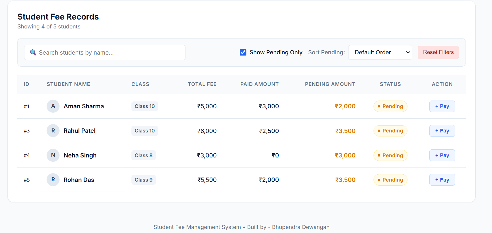

# 🎓 Student Fee Management Dashboard

A clean, responsive dashboard built with **Plain React**, **Vanilla CSS**, **Node.js/Express**, and **MySQL**.

---

## 📸 Running App Screenshots

 



---

## 🌟 Bonus Capabilities & Deployment

- **Vercel Deployment**: I have deployed multiple production web applications on Vercel. You can check out my deployed projects and live work on my portfolio:  
  👉 **[Portfolio: bhupendra-dewangan-17.web.app](https://bhupendra-dewangan-17.web.app/)**
- **Cloud Database Integration (Supabase / Cloud SQL)**: In addition to local MySQL, I have extensive experience integrating and deploying cloud databases like **Supabase** (PostgreSQL) and serverless backends:  
  👉 **[Live Projects: bhupendra-dewangan-17.web.app/project](https://bhupendra-dewangan-17.web.app/project)**

---

## ⚡ Quick Start

### Prerequisites
- Node.js (v16+)
- MySQL Server (running locally)

### 1. Setup & Installation
```bash
# Clone repository
git clone https://github.com/Bhupendra-17/Student-Fee-Management.git
cd Student-Fee-Management

# Install backend dependencies
cd backend && npm install && cd ..

# Install frontend dependencies
cd frontend && npm install && cd ..
```

### 2. Configure Database
1. Update `backend/.env` with your MySQL credentials:
   ```env
   PORT=5000
   DB_HOST=localhost
   DB_USER=root
   DB_PASSWORD=your_password
   DB_NAME=student_fee_db
   ```
2. Import schema & sample data:
   ```bash
   mysql -u root -p < database/schema.sql
   ```

### 3. Run Locally
- **Backend API**: `npm run server` (Runs on `http://localhost:5000`)
- **Frontend App**: `npm run client` (Runs on `http://localhost:5173`)
- **Run JS Solutions (Part B Test Suite)**: `npm run test:js`

---

## 🧠 Assignment Solutions

### Section B: JavaScript & Logical Problem-Solving

#### 1. Calculate Pending Fee & Overpayment Handling
```javascript
function calculatePending(totalFee, paidAmount) {
  const total = Number(totalFee) || 0;
  const paid = Number(paidAmount) || 0;
  return Math.max(0, total - paid);
}
```
> **Overpayment Handling:** Clamped to `0` (`Math.max(0, total - paid)`). If `paid > totalFee`, pending liability is 0, and surplus is recorded as an advance credit balance for subsequent terms.

#### 2. Filter Students with Pending Fees
```javascript
function filterPendingStudents(students) {
  return students.filter(s => calculatePending(s.totalFee, s.paidAmount) > 0);
}
```

#### 3. Calculate Totals
```javascript
function calculateTotals(students) {
  return students.reduce((acc, s) => {
    const fee = Number(s.totalFee) || 0;
    const paid = Number(s.paidAmount) || 0;
    acc.totalStudents += 1;
    acc.totalFees += fee;
    acc.totalPaid += paid;
    acc.totalPending += Math.max(0, fee - paid);
    return acc;
  }, { totalStudents: 0, totalFees: 0, totalPaid: 0, totalPending: 0 });
}
```

#### 4. Highest Pending Student
```javascript
function getHighestPendingStudent(students) {
  return students.reduce((highest, curr) => {
    const curP = calculatePending(curr.totalFee, curr.paidAmount);
    const hiP = highest ? calculatePending(highest.totalFee, highest.paidAmount) : -1;
    return curP > hiP ? curr : highest;
  }, null);
}
```

#### 5. Logic Question: Multiple Installments without Double-Counting
1. **Unique Transaction ID (Idempotency):** Every installment is assigned a unique primary key / transaction ID.
2. **Normalized 1-to-Many Ledger:** Payments are stored as individual rows in `payments`. We never increment a mutable `paid` column on the student table.
3. **Relational Aggregation:** Sum transactions using `SUM(amount)` grouped by `student_id`, or in JavaScript deduplicate by transaction ID with a `Map`/`Set` before summation.

---

### Section C: SQL and Database Fundamentals

*(All queries are runnable in [`database/queries.sql`](database/queries.sql))*

```sql
-- 1. Retrieve all students
SELECT id, name, class, total_fee FROM students;

-- 2. Retrieve all payments by a particular student
SELECT id, student_id, amount, payment_date, remarks FROM payments WHERE student_id = 1;

-- 3. Calculate total amount paid by each student
SELECT student_id, SUM(amount) AS total_paid FROM payments GROUP BY student_id;

-- 4. Display every student with total paid (including 0 payments)
SELECT s.id, s.name, s.class, s.total_fee,
       COALESCE(SUM(p.amount), 0) AS total_paid,
       (s.total_fee - COALESCE(SUM(p.amount), 0)) AS pending_fee
FROM students s
LEFT JOIN payments p ON s.id = p.student_id
GROUP BY s.id, s.name, s.class, s.total_fee;

-- 5. Find students whose total payments exceed 5,000
SELECT s.id, s.name, SUM(p.amount) AS total_paid
FROM students s
JOIN payments p ON s.id = p.student_id
GROUP BY s.id, s.name
HAVING SUM(p.amount) > 5000;

-- 6. Total amount collected during a given month
SELECT COALESCE(SUM(amount), 0) AS total_collected
FROM payments
WHERE payment_date >= '2026-08-01' AND payment_date < '2026-09-01';
```

#### Explanations:
- **INNER JOIN vs LEFT JOIN**:
  - `INNER JOIN` returns records only when matching rows exist in both tables (students with 0 payments would be omitted).
  - `LEFT JOIN` returns all records from `students` regardless of payments made, using `COALESCE(SUM(p.amount), 0)` to display `0` for unpaid students.
- **Why Foreign Keys are Useful**:
  - Enforces referential integrity (prevents orphaned payments for nonexistent students).
  - Enables cascading operations (`ON DELETE CASCADE`).
  - Optimizes JOIN queries through indexed relationship keys.

#### Proposed Schema Supporting Multiple Payments:
```sql
CREATE TABLE students (
    id INT AUTO_INCREMENT PRIMARY KEY,
    name VARCHAR(100) NOT NULL,
    class VARCHAR(20) NOT NULL,
    total_fee DECIMAL(10, 2) NOT NULL DEFAULT 0.00
);

CREATE TABLE payments (
    id INT AUTO_INCREMENT PRIMARY KEY,
    student_id INT NOT NULL,
    amount DECIMAL(10, 2) NOT NULL CHECK (amount > 0),
    payment_date DATE NOT NULL,
    remarks VARCHAR(255) DEFAULT 'Installment',
    FOREIGN KEY (student_id) REFERENCES students(id) ON DELETE CASCADE
);
```
*Supports multiple payments via a 1-to-many relationship: each installment is stored as an immutable row, and total paid is calculated on-the-fly via `SUM(amount)`.*

---

## 📁 Repository Structure

```
Student-Fee-Management/
├── database/
│   ├── schema.sql              # MySQL schema & seed data
│   └── queries.sql             # SQL tasks & theoretical explanations
├── solutions/
│   └── javascript_solutions.js # Part B problem-solving code & test runner
├── backend/
│   ├── server.js               # Minimal Express API with MySQL connection
│   └── .env.example            # Environment template
└── frontend/
    └── src/
        ├── App.jsx             # React dashboard state & filters
        ├── index.css           # Vanilla CSS (zero Tailwind/frameworks)
        ├── components/         # Modular SummaryCards, FilterBar, Table, Modal
        └── utils/              # Fee calculation utilities
```